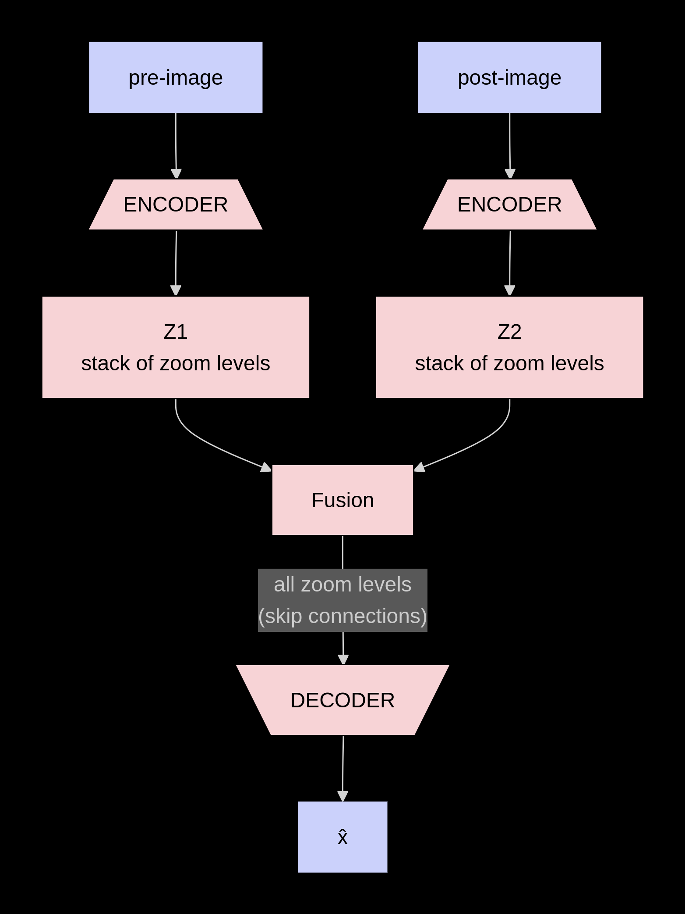

# Modelo de evaluación de daños (XView2)

## Problema

Dado un par de imágenes satelitales de la misma zona —una tomada **antes** de un desastre y otra **después**— queremos predecir, para cada píxel, cuánto daño ocurrió. Esta es la tarea del conjunto de datos [XView2](https://xview2.org/): un edificio que perdió altura, un techo que colapsó, una estructura que fue destruida. El modelo aprende a comparar las dos imágenes y produce un nivel de daño por píxel.

## Entrada y salida

### Entrada

La entrada es un único tensor con un eje temporal de longitud $T = 2$ (índice $0$ = antes, índice $1$ = después):

$$
X \in [0,1]^{B \times T \times 3 \times H \times W}, \qquad T = 2
$$

$$
X_{k,0} = x^{\text{before}}_k, \qquad X_{k,1} = x^{\text{after}}_k \qquad \in [0,1]^{3 \times H \times W}, \qquad k = 1,\dots,B
$$

### Salida

$$
\texttt{predict}(X) = \text{damage} \in [0,1]^{B \times C \times H \times W}, \qquad C = 5
$$

$$
\text{damage}[k,l,i,j] = \text{probability that pixel } (i,j) \text{ of pair of images } k \text{ has damage level } l, \quad l \in \{0,1,\dots,C-1\}
$$

$$
\sum_{l=0}^{C-1} \text{damage}[k,l,i,j] = 1
$$

## Arquitectura

Imaginemos una imagen en la que había un edificio antes de un desastre y, después, el edificio resultó dañado; digamos que perdió altura. Podemos resumir cómo ve esto el modelo, para fines de comprensión, pero esto es una **simplificación**.

#### Codificación compartida (la parte "siamesa")

Ambas imágenes pasan por el *mismo* codificador (mismos pesos). Esto las coloca en un **espacio de características común**, de modo que $Z_1$ y $Z_2$ se miden con la misma "regla" y pueden compararse directamente. Tomemos la altura de un edificio: $Z_1$ dice *"3 pisos antes"*, $Z_2$ dice *"8 pisos después"* — las mismas unidades, así que la comparación tiene sentido.

#### $Z$ es una pila de niveles de zoom

El codificador no describe la imagen una sola vez, la observa en varios **niveles de zoom** y conserva todos ellos:

- **Con zoom hacia dentro** (etapas tempranas): nítido y a tamaño completo, pero solo patrones pequeños (bordes, texturas). Sabe *dónde* están las cosas, no *qué* son.
- **Con zoom hacia fuera** (etapas profundas): una zona grande vista de una vez, pero borrosa. Sabe *qué* hay allí ("una casa cuyo techo ya no está"), no exactamente *dónde* están sus bordes.

Ambos son necesarios: para decir "esto es daño" debemos alejar el zoom para ver el contexto, y para dibujar el contorno de la parte dañada debemos acercar el zoom. Ningún nivel de zoom puede hacer ambas cosas, así que el codificador conserva toda la pila.

#### Fusión

El cambio se calcula **en cada nivel de zoom**: con zoom hacia dentro con zoom hacia dentro, con zoom hacia fuera con zoom hacia fuera, de modo que comparamos lo comparable. Con una diferencia, $Z_2 - Z_1$ calcula el cambio por ti: $8 - 3 = +5$ pisos, lo que nos dice que algo malo le ocurrió al edificio. El resultado es de nuevo una pila de niveles de zoom, pero ahora describe el *cambio*.

#### Decodificador

El decodificador comienza en el nivel de zoom más alejado, que sabe *qué* cambió pero es borroso, y vuelve a acercar el zoom paso a paso. En cada paso toma el nivel de zoom hacia dentro correspondiente de la fusión (la **conexión de salto**) para recuperar el detalle nítido que se perdió al alejar el zoom. A tamaño completo, produce una puntuación para cada nivel de daño en cada píxel ($\hat{x}$). Por esto existen las conexiones de salto: sin ellas, la salida sería correcta pero borrosa.

## Formulación

Es útil ver el modelo como una composición de funciones:

$$
\texttt{predict} = \operatorname{softmax} \circ D \circ \oplus \circ (E \times E) \circ \operatorname{split}
$$

donde $\operatorname{split}$ separa las dos imágenes a lo largo del eje temporal (sin pesos):

$$
\operatorname{split}(X) = \big( X^{(0)},\, X^{(1)} \big) = \big( x^{\text{before}},\, x^{\text{after}} \big), \qquad X^{(t)} \in [0,1]^{B \times 3 \times H \times W}
$$

con $X^{(t)}$ la imagen en el índice temporal $t$ de cada par en el lote, es decir, $X^{(t)}_k = X_{k,t}$.

Aplicado al tensor de entrada:

$$
\texttt{predict}(X) = \operatorname{softmax}\Big( D\Big( \oplus\big( E(X^{(0)}),\, E(X^{(1)}) \big) \Big) \Big)
$$

donde:

- $\operatorname{split}$ separa $X$ en las imágenes antes y después (sin pesos),
- $E$ es el codificador (pesos $p_E$, los mismos para ambas imágenes),
- $\oplus$ es la fusión por etapas: combina las dos imágenes codificadas en una única lista de mapas de características para el decodificador. Qué función usar es una decisión de diseño (pesos $p_\oplus$, posiblemente ninguno),
- $D$ es el decodificador (pesos $p_D$),
- $\operatorname{softmax}$ convierte puntuaciones en probabilidades (sin pesos).

## Cada función en detalle

**Codificador $E$.** Asigna una imagen a $S$ mapas de características, uno por etapa:

$$
E(x) = (h_1, \dots, h_S), \qquad h_s \in \mathbb{R}^{F_s \times H_s \times W_s} \text{ per sample}
$$

(como lote, $h_s \in \mathbb{R}^{B \times F_s \times H_s \times W_s}$). Se aplica a ambas imágenes con los mismos pesos:

$$
\big(h^{\text{before}}_1,\dots,h^{\text{before}}_S\big) = E(X^{(0)}), \qquad \big(h^{\text{after}}_1,\dots,h^{\text{after}}_S\big) = E(X^{(1)})
$$

**Fusión $\oplus$.** Combina las dos listas etapa por etapa, usando una función de fusión $\oplus_s$ por etapa (normalmente la misma $\oplus$ para todas las etapas):

$$
\oplus\big( (h^{\text{before}}_s)_{s}, (h^{\text{after}}_s)_{s} \big) = (g_1, \dots, g_S), \qquad g_s = h^{\text{before}}_s \oplus_s h^{\text{after}}_s
$$

con

$$
\oplus_s : \mathbb{R}^{F_s \times H_s \times W_s} \times \mathbb{R}^{F_s \times H_s \times W_s} \to \mathbb{R}^{G_s \times H_s \times W_s}
$$

El tamaño espacial se conserva. El número de canales $G_s$ depende de la fusión elegida (véase Decisiones de diseño), y el decodificador debe construirse para aceptar $G_s$ canales en cada etapa.

**Decodificador $D$.** Toma toda la lista fusionada (el mapa más profundo como entrada, los demás como conexiones de salto) y produce una puntuación por clase por píxel:

$$
\text{logits} = D(g_1, \dots, g_S) \in \mathbb{R}^{B \times C \times H \times W}
$$

**Softmax.** Se aplica sobre el eje de clases $l$:

$$
\text{damage}[k,l,i,j] = \frac{e^{\text{logits}[k,l,i,j]}}{\sum_{l'=0}^{C-1} e^{\text{logits}[k,l',i,j]}}
$$

## Decisiones de diseño

Algunas funciones del modelo no están fijadas por las matemáticas: son decisiones. La composición y las formas permanecen iguales sea cual sea la elección; solo cambian los detalles. Dos de ellas son las más importantes aquí: la fusión $\oplus$ y la función de pérdida. (Las arquitecturas del codificador y del decodificador también son elecciones, pero no se detallan aquí.)

### Fusión $\oplus$

Cualquiera de estas encaja en la misma composición; solo cambia $G_s$ (y si hay pesos):

| Fusión | $h^{\text{b}} \oplus h^{\text{a}}$ | $G_s$ | Pesos |
|---|---|---|---|
| Diferencia | $h^{\text{a}} - h^{\text{b}}$ | $F_s$ | ninguno |
| Diferencia absoluta | $\lvert h^{\text{a}} - h^{\text{b}} \rvert$ | $F_s$ | ninguno |
| Concatenación | $[h^{\text{b}},\, h^{\text{a}}]$ a lo largo de canales | $2F_s$ | ninguno |
| Concatenación + diferencias | $[h^{\text{b}},\, h^{\text{a}},\, h^{\text{a}} - h^{\text{b}},\, \lvert h^{\text{a}} - h^{\text{b}} \rvert]$ | $4F_s$ | ninguno |
| Aprendida | $\operatorname{Conv}\big([h^{\text{b}},\, h^{\text{a}}]\big)$ (p. ej., conv $1 \times 1$, opcionalmente seguida de $3 \times 3$) | elegido | sí ($p_\oplus$) |

El orden importa para las opciones no simétricas: la diferencia $h^{\text{a}} - h^{\text{b}}$ no es lo mismo que $h^{\text{b}} - h^{\text{a}}$, y el orden de concatenación fija qué canales son "antes". Mantén esto consistente entre entrenamiento e inferencia.

**Dónde ocurre la fusión.** Aquí $\oplus$ actúa sobre las salidas del codificador, antes del decodificador. Algunos modelos, en cambio, ejecutan una U-Net compartida completa (codificador y decodificador) sobre cada imagen y fusionan las dos salidas del decodificador después. Esa es una composición diferente (la fusión se mueve después de $D$, y una pequeña cabeza la sigue), no solo una elección diferente de $\oplus$.

## Notas

**Mismos pesos, una sola llamada.** Como $E$ tiene los mismos pesos para ambas imágenes, aplicarlo dos veces equivale a apilar las dos imágenes en un solo lote de tamaño $2B$, codificar una vez y desapilar el resultado. En la disposición del tensor esto es el reshape entre $[B, T, 3, H, W]$ y $[B \cdot T, 3, H, W]$, así que $\operatorname{split}$ y $E \times E$ pueden implementarse como un reshape, una llamada al codificador y un reshape de vuelta.

**Logits.** Los logits son las puntuaciones sin procesar, sin normalizar, que produce la red, una por clase por píxel. Pueden ser cualquier número real (negativo, mayor que 1, etc.), así que todavía no son probabilidades. Un logit más alto para una clase significa que el modelo favorece más esa clase. El nombre proviene de la inversa de la función logística, pero en la práctica solo significa "puntuaciones sin procesar antes de softmax".

**Softmax.** Softmax convierte un vector de $C$ puntuaciones reales en $C$ probabilidades: cada salida es positiva (debido a la exponencial) y suman 1 (debido a la división por el total). Conserva el orden (el logit más grande obtiene la probabilidad más grande) y amplifica las diferencias entre puntuaciones. Aquí se aplica de forma independiente en cada píxel $(k,i,j)$, a lo largo del eje de clases $l$ (el segundo eje de la disposición con canales primero $[B, C, H, W]$).
