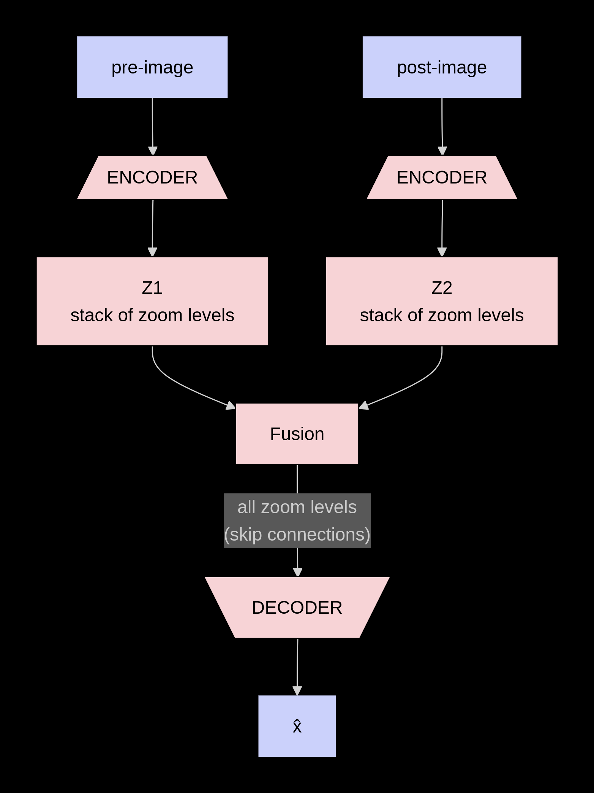

# Damage Assessment Model (XView2)

## Problem

Given a pair of satellite images of the same area — one taken **before** a disaster and one **after** — we want to predict, for every pixel, how much damage occurred. This is the task of the [XView2](https://xview2.org/) dataset: a building that lost height, a roof that collapsed, a structure that was destroyed. The model learns to compare the two images and output a per-pixel damage level.

## Input and Output

### Input

The input is a single tensor with a time axis of length $T = 2$ (index $0$ = before, index $1$ = after):

$$
X \in [0,1]^{B \times T \times 3 \times H \times W}, \qquad T = 2
$$

$$
X_{k,0} = x^{\text{before}}_k, \qquad X_{k,1} = x^{\text{after}}_k \qquad \in [0,1]^{3 \times H \times W}, \qquad k = 1,\dots,B
$$

### Output

$$
\texttt{predict}(X) = \text{damage} \in [0,1]^{B \times C \times H \times W}, \qquad C = 5
$$

$$
\text{damage}[k,l,i,j] = \text{probability that pixel } (i,j) \text{ of pair of images } k \text{ has damage level } l, \quad l \in \{0,1,\dots,C-1\}
$$

$$
\sum_{l=0}^{C-1} \text{damage}[k,l,i,j] = 1
$$

## Architecture

Let's imagine a picture where there was a building before a disaster and, after it, the building was damaged; let's say it lost its height. We can summarize how the model sees this, for understanding purposes, but this is a **simplification**.

#### Shared encoding (the "siamese" part)

Both images go through the *same* encoder (same weights). This puts them into a **common feature space**, so $Z_1$ and $Z_2$ are measured with the same "ruler" and can be compared directly. Take a building's height: $Z_1$ says *"3 floors before"*, $Z_2$ says *"8 floors after"* — same units, so the comparison is meaningful.

#### $Z$ is a stack of zoom levels

The encoder does not describe the image once, it looks at it at several **zoom levels** and keeps all of them:

- **Zoomed in** (early stages): sharp and full size, but only small patterns (edges, textures). It knows *where* things are, not *what* they are.
- **Zoomed out** (deep stages): a large area seen at once, but blurry. It knows *what* is there ("a house whose roof is gone"), not exactly *where* its edges are.

Both are needed: to say "this is damage" we must zoom out to see the context, and to draw the outline of the damaged part we must zoom in. No single zoom level can do both, so the encoder keeps the whole stack.

#### Fusion

The change is computed **at every zoom level**: zoomed-in with zoomed-in, zoomed-out with zoomed-out, so we compare like with like. With a difference, $Z_2 - Z_1$ computes the change for you: $8 - 3 = +5$ floors, which tells us that something bad happened to the building. The result is again a stack of zoom levels, but now it describes the *change*.

#### Decoder

The decoder starts at the most zoomed-out level, which knows *what* changed but is blurry, and zooms back in step by step. At each step it takes the matching zoomed-in level from the fusion (the **skip connection**) to recover the sharp detail that was lost by zooming out. At full size, it gives a score for each damage level at every pixel ($\hat{x}$). This is why the skip connections are there: without them, the output would be correct but blurry.

## Formulation

It is useful to look at the model as a composition of functions:

$$
\texttt{predict} = \operatorname{softmax} \circ D \circ \oplus \circ (E \times E) \circ \operatorname{split}
$$

where $\operatorname{split}$ separates the two images along the time axis (no weights):

$$
\operatorname{split}(X) = \big( X^{(0)},\, X^{(1)} \big) = \big( x^{\text{before}},\, x^{\text{after}} \big), \qquad X^{(t)} \in [0,1]^{B \times 3 \times H \times W}
$$

with $X^{(t)}$ the image at time index $t$ of every pair in the batch, that is $X^{(t)}_k = X_{k,t}$.

Applied to the input tensor:

$$
\texttt{predict}(X) = \operatorname{softmax}\Big( D\Big( \oplus\big( E(X^{(0)}),\, E(X^{(1)}) \big) \Big) \Big)
$$

where:

- $\operatorname{split}$ separates $X$ into the before and after images (no weights),
- $E$ is the encoder (weights $p_E$, the same for both images),
- $\oplus$ is the stage-wise fusion: it combines the two encoded images into a single list of feature maps for the decoder. Which function to use is a design decision (weights $p_\oplus$, possibly none),
- $D$ is the decoder (weights $p_D$),
- $\operatorname{softmax}$ turns scores into probabilities (no weights).

## Each function in detail

**Encoder $E$.** It maps an image to $S$ feature maps, one per stage:

$$
E(x) = (h_1, \dots, h_S), \qquad h_s \in \mathbb{R}^{F_s \times H_s \times W_s} \text{ per sample}
$$

(as a batch, $h_s \in \mathbb{R}^{B \times F_s \times H_s \times W_s}$). It is applied to both images with the same weights:

$$
\big(h^{\text{before}}_1,\dots,h^{\text{before}}_S\big) = E(X^{(0)}), \qquad \big(h^{\text{after}}_1,\dots,h^{\text{after}}_S\big) = E(X^{(1)})
$$

**Fusion $\oplus$.** It combines the two lists stage by stage, using one fusion function $\oplus_s$ per stage (usually the same $\oplus$ for all stages):

$$
\oplus\big( (h^{\text{before}}_s)_{s}, (h^{\text{after}}_s)_{s} \big) = (g_1, \dots, g_S), \qquad g_s = h^{\text{before}}_s \oplus_s h^{\text{after}}_s
$$

with

$$
\oplus_s : \mathbb{R}^{F_s \times H_s \times W_s} \times \mathbb{R}^{F_s \times H_s \times W_s} \to \mathbb{R}^{G_s \times H_s \times W_s}
$$

The spatial size is preserved. The number of channels $G_s$ depends on the chosen fusion (see Design choices), and the decoder must be built to accept $G_s$ channels at each stage.

**Decoder $D$.** It takes the whole fused list (the deepest map as input, the others as skip connections) and outputs one score per class per pixel:

$$
\text{logits} = D(g_1, \dots, g_S) \in \mathbb{R}^{B \times C \times H \times W}
$$

**Softmax.** Applied over the class axis $l$:

$$
\text{damage}[k,l,i,j] = \frac{e^{\text{logits}[k,l,i,j]}}{\sum_{l'=0}^{C-1} e^{\text{logits}[k,l',i,j]}}
$$

## Design choices

Some functions of the model are not fixed by the math: they are decisions. The composition and the shapes stay the same whatever is chosen, only the details change. Two of them matter most here: the fusion $\oplus$ and the loss function. (The encoder and decoder architectures are also choices, but they are not detailed here.)

### Fusion $\oplus$

Any of these fits the same composition; only $G_s$ (and whether there are weights) changes:

| Fusion | $h^{\text{b}} \oplus h^{\text{a}}$ | $G_s$ | Weights |
|---|---|---|---|
| Difference | $h^{\text{a}} - h^{\text{b}}$ | $F_s$ | none |
| Absolute difference | $\lvert h^{\text{a}} - h^{\text{b}} \rvert$ | $F_s$ | none |
| Concatenation | $[h^{\text{b}},\, h^{\text{a}}]$ along channels | $2F_s$ | none |
| Concatenation + differences | $[h^{\text{b}},\, h^{\text{a}},\, h^{\text{a}} - h^{\text{b}},\, \lvert h^{\text{a}} - h^{\text{b}} \rvert]$ | $4F_s$ | none |
| Learned | $\operatorname{Conv}\big([h^{\text{b}},\, h^{\text{a}}]\big)$ (e.g. $1 \times 1$ conv, optionally followed by $3 \times 3$) | chosen | yes ($p_\oplus$) |

Order matters for the non-symmetric choices: the difference $h^{\text{a}} - h^{\text{b}}$ is not the same as $h^{\text{b}} - h^{\text{a}}$, and concatenation order fixes which channels are "before". Keep it consistent between training and inference.

**Where the fusion happens.** Here $\oplus$ acts on the encoder outputs, before the decoder. Some models instead run a full shared U-Net (encoder and decoder) on each image and fuse the two decoder outputs afterwards. That is a different composition (the fusion moves after $D$, and a small head follows it), not just a different choice of $\oplus$.

## Notes

**Same weights, one call.** Because $E$ has the same weights for both images, applying it twice is equivalent to stacking the two images into one batch of size $2B$, encoding once, and unstacking the result. In the tensor layout this is the reshape between $[B, T, 3, H, W]$ and $[B \cdot T, 3, H, W]$, so $\operatorname{split}$ and $E \times E$ can be implemented as one reshape, one encoder call and one reshape back.

**Logits.** The logits are the raw, unnormalized scores the network outputs, one per class per pixel. They can be any real number (negative, greater than 1, etc.), so they are not probabilities yet. A higher logit for a class means the model favors that class more. The name comes from the inverse of the logistic function, but in practice it just means "raw scores before softmax".

**Softmax.** Softmax converts a vector of $C$ real scores into $C$ probabilities: each output is positive (because of the exponential) and they sum to 1 (because of the division by the total). It preserves ordering (the largest logit gets the largest probability) and amplifies differences between scores. Here it is applied independently at each pixel $(k,i,j)$, across the class axis $l$ (the second axis of the channels-first layout $[B, C, H, W]$).
